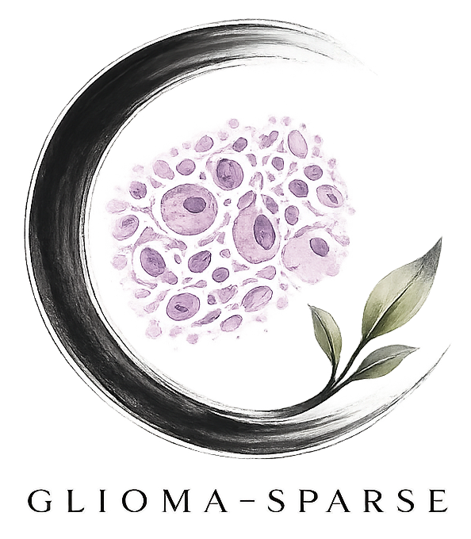
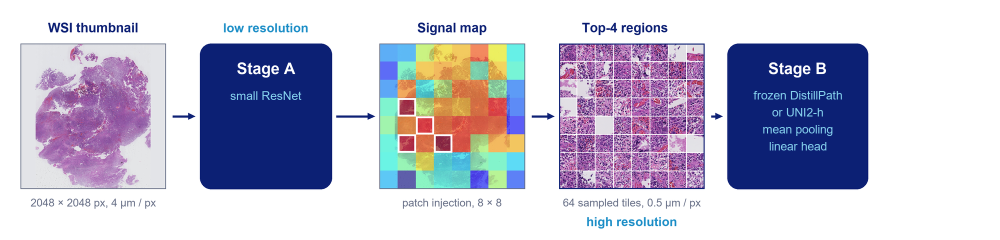

<p align="center">
  
</p>

# Glioma-SPARSE

## A Low-Compute Deep Learning Approach for Accessible Glioma Characterisation from Routine Histopathology

[App](#app) | [Versions](#versions) | [Installation](#installation) | [Retraining](#retraining) | [Cite](#citation)

  * [Description](#description)
  * [App](#app)
  * [Versions](#versions)
  * [Dashboard](#dashboard)
  * [Installation](#installation)
  * [Retraining](#retraining)
  * [Repository structure](#repository-structure)
  * [Notes on usage](#notes-on-usage)
  * [Acknowledgements and references](#acknowledgements-and-references)
  * [Citation](#citation)


## Description

Glioma-SPARSE classifies gliomas (WHO 2021: control, astrocytoma low/high grade, oligodendroglioma low/high grade, glioblastoma) from routine H&E whole-slide images without encoding the whole slide at high resolution. Instead of running a foundation model over every tile of a gigapixel slide, it first looks at the slide as a whole at low resolution, finds where the diagnostic signal is, and only then reads a few tiles of those regions at high resolution.

* **Stage A: thumbnail grading.** A ResNet-50 (or ResNet-18) grades the slide (control / low grade / high grade) from a single 2048x2048 thumbnail (4 µm/pixel). It is trained on thumbnails cut into an 8x8 grid of patches that are shuffled at every step, so it learns what the tissue looks like, not where it sits on the slide.
* **Patch injection.** To find which parts of the slide drive the grade, every thumbnail patch is injected one at a time into a shuffled control slide, and the rise in the predicted-grade logit is recorded. Because the model is position-invariant, this rise reflects the content of the injected patch only. A feature of the last layer only sees a window of the image, so each injection is computed exactly on a crop around the patch, at about a quarter of the cost. The result is a signal map over the slide; the patches above its 95th percentile (at most four, with enough tissue) are the patch-regions.
* **Stage B: foundation model on tiles from the patch-regions.** The patch-regions are mapped back to the full-resolution slide and a small random sample of 20x tiles (256 px) inside them, 64 by default, is encoded by a frozen pathology foundation model: DistillPath-KS16-UNI2h (22M parameters, a ViT-S/16 distilled from UNI2-h) or, in the `full` branch, UNI2-h (681M, the main analysis of the paper). The tile features are averaged and a logistic-regression head predicts the molecular type (IDH-mutant, IDH-mutant 1p/19q-codeleted, IDH-wildtype). Grade and molecular type combine into the integrated diagnosis.

The design splits the problem by the resolution it needs. Grade comes from a low-resolution thumbnail alone, which any slide scanner can provide. The signal map shows where the evidence for the prediction lies, and every Stage B tile has an exact contribution to the molecular prediction (the head is linear). High resolution is needed only inside the patch-regions, about a tenth of the tissue, so only those have to be read or scanned at 20x.




## App

To run Glioma-SPARSE on your own slides without installing anything, download the app from the [latest release](https://github.com/T-AbdelAlim/Glioma-SPARSE/releases/latest):

| App | Runs on |
|---|---|
| `GliomaSPARSE-Dashboard-Windows.zip` | Windows 10 or 11 (64-bit), on the processor |
| `GliomaSPARSE-Dashboard-macOS.zip` | macOS on Apple silicon (M1 or later), on the processor |

Unzip it and start `GliomaSPARSE-Dashboard-Windows.exe` or `GliomaSPARSE-Dashboard-macOS.app`. The trained models are included; DistillPath ([RamonK/DistillPath-KS16-UNI2h](https://huggingface.co/RamonK/DistillPath-KS16-UNI2h), non-commercial licence) is downloaded once on first use (86 MB), without an access request. A slide takes one to two minutes on a laptop processor. The apps are not signed: on Windows, choose *More info > Run anyway* the first time; on macOS, right-click the app and choose *Open*.


## Versions

Each branch contains the previous one.

| Branch | For | Stage B encoder | Needs |
|---|---|---|---|
| `light-release` | running Glioma-SPARSE from source (dashboard); the apps are built from it | DistillPath | nothing gated |
| `main` | `light-release` plus retraining on your own slides | DistillPath | [TRIDENT](https://github.com/mahmoodlab/TRIDENT) for retraining |
| `full` | `main` plus UNI2-h, the encoder of the paper's main analysis | DistillPath and UNI2-h | access to [UNI2-h](https://huggingface.co/MahmoodLab/UNI2-h) |

The trained models (Stage A checkpoints, Stage B heads and the control image for patch injection) are attached to the [release](https://github.com/T-AbdelAlim/Glioma-SPARSE/releases/latest) as `Glioma-SPARSE-models.zip`; unzip it in the repository root. The apps carry them already.


## Dashboard

The dashboard runs the full pipeline on a slide: import a whole-slide image, grade it, inspect the signal map and the patch-regions, and get the molecular type and integrated diagnosis, with the Stage B evidence map showing the contribution of every tile. A step-by-step explainer of the method is built in. It is what the apps run; from source (after [installation](#installation)):
```
python -m scripts.dashboard.run_dashboard
```

The slider of Stage B sets the number of 20x tiles: 8 to 1,024, or all tiles in the patch-regions. In the `full` branch Stage B also runs with UNI2-h, which is gated: request access at [MahmoodLab/UNI2-h](https://huggingface.co/MahmoodLab/UNI2-h); the dashboard finds `pytorch_model.bin` in `models/UNI2-h/`, the Hugging Face cache or `GLIOMA_SPARSE_UNI2H_CKPT`, or asks for it once. See [scripts/dashboard/README.md](scripts/dashboard/README.md).

**Model.** The dashboard uses the models of cross-validation fold 5, which had the highest mean accuracy on its internal test slides and on the TCGA slides: its Stage A network grades the slide and selects up to four patch-regions, and its head classifies the molecular type from the tiles in them. As in the paper, the grade and type probabilities give a score for each of the six diagnoses, and the diagnosis is the class with the highest score. With DistillPath, fold 5 alone reached 0.82 on its internal test slides and about 0.50 on TCGA (the paper's TCGA result, 0.56, averages all five fold models). Its grades are identical to those of the paper's fold-5 model, and so are its patch-regions on the TCGA slides checked.

**Confidence.** Each stage reports a confidence of 1 − H(p)/log K, where H(p) is the entropy of its predicted probabilities over K classes (1: all probability on one class; 0: equal probabilities); the integrated confidence is the product of the two (for control tissue, the Stage A confidence). On the internal test predictions of the paper with DistillPath (220 predictions, each by its own fold's models), the diagnosis was correct in 94% of predictions with a confidence of 0.90 or more (22% of them), in 83% of those between 0.60 and 0.90 and in 58% of those below 0.60; with UNI2-h these were 94%, 84% and 60%. This does not carry over to slides from other centres: on the 180 TCGA slides, the fold-5 models never reached 0.90, 7 of the 8 predictions between 0.60 and 0.90 were correct, and 46% of the others. The grade confidence transferred least: a single fold model's grade with a confidence of 0.90 or more was right in 95% of internal slides but in 73% of TCGA slides; the confidence of the molecular type held up better (at 0.84 or more, right in 94% internally and in 89% on TCGA). Read the confidence as a ranking of predictions, not as the probability that a prediction is correct.


## Installation

Requires Python 3.14. A GPU is optional: on a laptop processor alone, a slide takes one to two minutes (under half a minute with a GPU).

```
git clone https://github.com/T-AbdelAlim/Glioma-SPARSE.git
cd Glioma-SPARSE
powershell -ExecutionPolicy Bypass -File setup_env.ps1     # windows
bash setup_env.sh                                          # linux
```

This creates `.venv` with the pinned environment (`requirements-lock.txt`, PyTorch with CUDA 12.6), installs `glioma_sparse` in editable mode and runs `python -m scripts.check_setup`, which also reports whether the trained models are in place. With conda: `conda env create -f environment.yml`. `requirements.txt` lists the unpinned direct dependencies for other platforms (install PyTorch first).


## Retraining

Branches `main` and `full`. All entry points are run as modules from the repository root. The defaults reproduce the trained models of the paper.

**1. Thumbnails.** Each slide becomes a 2048x2048 thumbnail at 4 µm/pixel plus a JSON sidecar that maps thumbnail pixels to level-0 slide coordinates. The slides are organised in one folder per WHO 2021 class (`astro_IDHmt_G2`, `astro_IDHmt_G3`, `astro_IDHmt_G4`, `oligo_IDHmt_1p19qdel_G2`, `oligo_IDHmt_1p19qdel_G3`, `GBM_IDHwt`, `control`); slides with too little tissue are set aside:
```
python -m scripts.data.process_wsi_folder --wsi-root <slides>
```

**2. Cross-validation splits.** Five stratified 80/10/10 splits, shared by both stages (the paper's splits are in `splits/`):
```
python -m scripts.data.generate_splits
```

**3. Stage A.** One fold per run; classes `0 = control, 1 = low_grade, 2 = high_grade`, with class-weighted loss, tile shuffling on the training set and early stopping on validation. Each run saves its checkpoints (`best_f1.pth`, `best_auc.pth`, ...), predictions, metrics and an `efficiency.json` with parameters, FLOPs, time and energy; `aggregate_splits` summarises the five folds. For the dashboard, place the runs (one per split; the dashboard uses the run of split 5) in `ResNet50_output/training_output/` (or `ResNet18_output/`).
```
python -m scripts.stage_a.train --split-csv splits/split_01.csv --model resnet50
python -m scripts.data.aggregate_splits
```

**4. Patch-regions.** Each fold's Stage A selects the patch-regions of that fold's slides: at least 50% tissue on training and validation slides, and on test slides the same selection as at inference (25% tissue, none when Stage A predicts control):
```
python -m scripts.stage_b.select_regions --model resnet50 ^
    --checkpoints-glob "ResNet50_output/training_output/*_split_0*/best_f1.pth" --out data/regions_rn50_f1.csv
```
`compute_risk_map(..., method="crop")` gives the same signal map with about a quarter of the computation: a last-layer feature of the ResNet only sees a window of the image (427 px for ResNet-50), so the control is passed once and each injected patch only within a crop around it (the patch plus 448 px on each side). The dashboard and the apps use it, and so does `select_regions --method crop`. The default `full` passes the whole thumbnail for every patch and reproduces the patch-regions of the released models exactly; with `crop`, the patch-regions of all validation and test slides are the same, and a few training slides get another region where two patches had near-equal signal.

**5. Tiles.** Stage B uses the 20x, 256 px tiles of [TRIDENT](https://github.com/mahmoodlab/TRIDENT) (install it, or clone it next to this repository as `../mahmoodlab/TRIDENT`). Segment and tile the slides with TRIDENT (no features needed), from the TRIDENT folder:
```
python run_batch_of_slides.py --task seg --wsi_dir <slides> --job_dir <trident job> --segmenter hest
python run_batch_of_slides.py --task coords --wsi_dir <slides> --job_dir <trident job> --mag 20 --patch_size 256 --overlap 0
```
and encode the tiles inside the patch-regions with DistillPath (GPU recommended):
```
python -m scripts.stage_b.encode_tiles --regions data/regions_rn50_f1.csv --trident-dir <trident job> ^
    --wsi-root <slides> --out data/tile_features/distillpath
```
In the `full` branch, UNI2-h features come from TRIDENT itself (`--task feat --patch_encoder uni_v2`, giving `features_uni_v2/<slide_id>.h5`).

**6. Stage B heads.** Per fold, n tiles are drawn at random among the tiles inside the slide's patch-regions (n = 8 to 1,024, or all), their features are averaged and a class-balanced logistic regression is fitted, with C chosen on the validation slides. The heads go to `data/resuni_heads/<config>/`, where the dashboard finds them:
```
python -m scripts.stage_b.fit_heads --regions data/regions_rn50_f1.csv ^
    --features-dir data/tile_features/distillpath --config rn50_f1_dp_uni2h
```
For UNI2-h (`full` branch): `--features-dir <trident job>/20x_256px_0px_overlap/features_uni_v2 --config rn50_f1`.


## Repository structure

```
src/glioma_sparse/
  preprocessing/     thumbnails and mapping sidecars, stain correction
  interpret/         patch injection, thumbnail-to-slide mapping
  models/            Stage A factory, Stage B (resuni.py: DistillPath; uni2h.py: UNI2-h, full branch)
  data_utils/        datasets, tile shuffling, transforms
  evaluation/        metrics and plots                              (main, full)
  training/          training loop, seeding                         (main, full)
scripts/
  dashboard/         interactive dashboard and the apps (build_exe.py)
  check_setup.py     environment and trained-model check
  data/              thumbnails, splits, five-fold summary          (main, full)
  stage_a/           Stage A training                               (main, full)
  stage_b/           patch-regions, tile encoding, Stage B heads    (main, full)
  lib/               metrics and compute profiling                  (main, full)
splits/              the five cross-validation splits of the paper  (main, full)
.github/workflows/   builds the Windows and macOS apps for a release
```


## Notes on usage

**Research use only, not a medical device.** Glioma-SPARSE has not been assessed or certified under the EU Medical Device Regulation (MDR), the FDA or any equivalent framework, and is not intended for clinical diagnosis or any other patient-care decision.

UNI2-h, DistillPath and TRIDENT are third-party software and models with their own licences and terms of use; the DistillPath and UNI2-h weights are licensed for non-commercial use only, and UNI2-h requires an access request. The trained Glioma-SPARSE models in the release are derived from the Digital Brain Tumour Atlas; follow its terms of use. The code is released under the MIT licence (`LICENSE`).


## Acknowledgements and references

Glioma-SPARSE builds on the following data, models, tools and libraries. Please cite them as well when you use the corresponding parts.

**Data**
* The models were trained on the [Digital Brain Tumour Atlas](https://doi.org/10.1038/s41597-022-01157-0) (EBRAINS): Roetzer-Pejrimovsky T, et al. The Digital Brain Tumour Atlas, an open histopathology resource. *Sci Data* 2022;9:55. doi:10.1038/s41597-022-01157-0
* External validation in the paper used whole-slide images of [The Cancer Genome Atlas](https://www.cancer.gov/tcga) (TCGA) Research Network.

**Models**
* Stage A: ResNet-18 and ResNet-50 (He K, Zhang X, Ren S, Sun J. Deep residual learning for image recognition. *CVPR* 2016:770–8. doi:10.1109/CVPR.2016.90), initialised with ImageNet weights from torchvision (Deng J, et al. ImageNet: a large-scale hierarchical image database. *CVPR* 2009:248–55. doi:10.1109/CVPR.2009.5206848).
* Stage B, DistillPath: [RamonK/DistillPath-KS16-UNI2h](https://huggingface.co/RamonK/DistillPath-KS16-UNI2h). Kaspar R, Ignatov A, Boeva V. DistillPath: an efficient 22M distilled pathology encoder approaching large foundation model performance. arXiv 2026. doi:10.48550/arXiv.2608.17872. Its student initialisation is the kaiko ViT-S/16 (Aben N, et al. Towards large-scale training of pathology foundation models. arXiv 2024. doi:10.48550/arXiv.2404.15217).
* Stage B, UNI2-h (`full` branch): [MahmoodLab/UNI2-h](https://huggingface.co/MahmoodLab/UNI2-h), [github.com/mahmoodlab/UNI](https://github.com/mahmoodlab/UNI). Chen RJ, Ding T, Lu MY, et al. Towards a general-purpose foundation model for computational pathology. *Nat Med* 2024;30:850–62. doi:10.1038/s41591-024-02857-3

**Tools**
* [TRIDENT](https://github.com/mahmoodlab/TRIDENT) for tissue segmentation, tiling and UNI2-h features when retraining Stage B: Zhang A, Jaume G, Vaidya A, Ding T, Mahmood F. Accelerating data processing and benchmarking of AI models for pathology. arXiv 2025. doi:10.48550/arXiv.2502.06750. Its tissue segmenter comes from HEST (Jaume G, et al. HEST-1k: a dataset for spatial transcriptomics and histology image analysis. *NeurIPS Datasets and Benchmarks* 2024).
* [OpenSlide](https://openslide.org) for reading whole-slide images: Goode A, Gilbert B, Harkes J, Jukic D, Satyanarayanan M. OpenSlide: a vendor-neutral software foundation for digital pathology. *J Pathol Inform* 2013;4:27. doi:10.4103/2153-3539.119005

**Libraries**
* [PyTorch](https://pytorch.org) and torchvision for the ResNet models, training and inference: Paszke A, et al. PyTorch: an imperative style, high-performance deep learning library. *NeurIPS* 2019.
* [timm](https://github.com/huggingface/pytorch-image-models) (PyTorch Image Models, Wightman R) for the vision transformers of Stage B, with [Hugging Face Hub](https://github.com/huggingface/huggingface_hub) and safetensors for downloading DistillPath.
* [scikit-learn](https://scikit-learn.org) for the Stage B logistic-regression heads and the metrics: Pedregosa F, et al. Scikit-learn: machine learning in Python. *J Mach Learn Res* 2011;12:2825–30.
* [NumPy](https://numpy.org) (Harris CR, et al. Array programming with NumPy. *Nature* 2020;585:357–62. doi:10.1038/s41586-020-2649-2), [pandas](https://pandas.pydata.org), [SciPy](https://scipy.org), [h5py](https://www.h5py.org), [Pillow](https://python-pillow.org), [OpenCV](https://opencv.org) and [Matplotlib](https://matplotlib.org) for data handling, images and figures; [openpyxl](https://openpyxl.readthedocs.io) for the reports.
* [FastAPI](https://fastapi.tiangolo.com), [Uvicorn](https://www.uvicorn.org) and [pywebview](https://pywebview.flowrl.com) for the dashboard, and [PyInstaller](https://pyinstaller.org) for the apps.


## Citation

Kindly consider citing the work if it supports your research:

_Abdel Alim et al. Glioma-SPARSE: A Low-Compute Deep Learning Approach for Accessible Glioma Characterisation from Routine Histopathology. Manuscript in preparation (2026)._

**Github Repository:**
```
Abdel Alim, T. (2026). Glioma-SPARSE [Computer software]. https://github.com/T-AbdelAlim/Glioma-SPARSE
```
