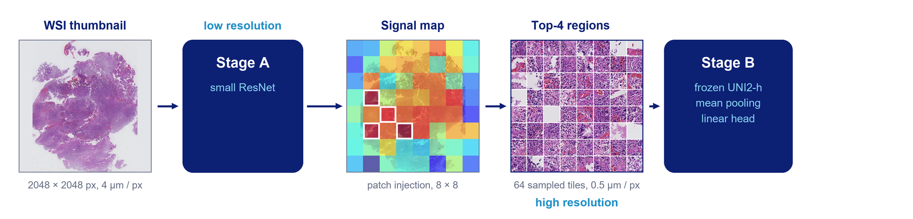

<p align="center">
  
</p>

# Glioma-SPARSE

## A Low-Compute Deep Learning Approach for Accessible Glioma Characterisation from Routine Histopathology

[Dashboard](#dashboard) | [Installation](#installation) | [Usage](#usage) | [Cite](#citation)

  * [Description](#description)
  * [Dashboard](#dashboard)
  * [Installation](#installation)
  * [Usage](#usage)
    * [Preprocessing](#1-preprocessing)
    * [Cross-validation splits](#2-cross-validation-splits)
    * [Stage A: thumbnail grading](#3-stage-a-thumbnail-grading)
    * [Patch injection and region selection](#4-patch-injection-and-region-selection)
    * [Stage B: vision transformer on the selected tiles](#5-stage-b-vision-transformer-on-the-selected-tiles)
    * [Evaluation](#6-evaluation)
  * [Repository structure](#repository-structure)
  * [Notes on usage](#notes-on-usage)
  * [Citation](#citation)


## Description

Glioma-SPARSE classifies gliomas (WHO 2021: control, astrocytoma low/high grade, oligodendroglioma low/high grade, glioblastoma) from routine H&E whole-slide images without encoding the whole slide at high resolution. Instead of running a foundation model over every tile of a gigapixel slide, it first looks at the slide as a whole at low resolution, finds where the diagnostic signal is, and only then reads a few tiles of those regions at high resolution.

* **Stage A: thumbnail grading.** A ResNet-50 grades the slide (control / low grade / high grade) from a single 2048x2048 thumbnail (4 µm/pixel). It is trained on thumbnails cut into an 8x8 grid of tiles that are shuffled at every step, so it learns what the tissue looks like, not where it sits on the slide.
* **Patch injection.** To find which regions drive the grade, every thumbnail tile is injected one at a time into a shuffled control slide, and the rise in the predicted-grade logit is recorded. Because the model is position-invariant, this rise reflects the content of the injected tile only. The result is a signal map over the slide; the tiles above its 95th percentile (at most four, with enough tissue) are the high-risk regions.
* **Stage B: vision transformer on the high-risk tiles.** The selected regions are mapped back to the full-resolution slide and a small random sample of 20x tiles inside them (64 by default) is encoded by a frozen pathology vision transformer (UNI2-h). The tile features are averaged and a logistic-regression head predicts the molecular type (IDH-mutant, IDH-mutant 1p/19q-codeleted, IDH-wildtype). Grade and molecular type combine into the integrated diagnosis.

The design matches compute to the difficulty of each subproblem: grading at low resolution with a small network, molecular typing from a few high-resolution tiles. The signal map doubles as a localisation of the diagnostic regions, and every Stage B tile has an exact contribution to the molecular prediction (the head is linear).




## Dashboard

The interactive dashboard runs the full pipeline on a slide without the command line: import a whole-slide image, grade it, inspect the signal map and the selected regions, and get the molecular type and integrated diagnosis, with the Stage B evidence map showing the contribution of every tile. A step-by-step explainer of the method is built in.

```
python -m scripts.dashboard.run_dashboard
```

A standalone Windows build (no Python needed) is made with `python scripts\dashboard\build_exe.py` and bundles the trained Stage A models and Stage B heads. The UNI2-h weights are gated and never bundled: request access at [MahmoodLab/UNI2-h](https://huggingface.co/MahmoodLab/UNI2-h). The app finds `pytorch_model.bin` in `models/UNI2-h/`, the Hugging Face cache or `GLIOMA_SPARSE_UNI2H_CKPT`, or asks for it once. See [scripts/dashboard/README.md](scripts/dashboard/README.md).


## Installation

Requires Python 3.14 and an NVIDIA GPU for reasonable speed (everything also runs on CPU).

```
git clone https://github.com/T-AbdelAlim/Glioma-SPARSE.git
cd Glioma-SPARSE
powershell -ExecutionPolicy Bypass -File setup_env.ps1     # windows
bash setup_env.sh                                          # linux
```

This creates `.venv` with the pinned environment (`requirements-lock.txt`, PyTorch with CUDA 12.6), installs `glioma_sparse` in editable mode and runs `python -m scripts.check_setup`. With conda: `conda env create -f environment.yml`. `requirements.txt` lists the unpinned direct dependencies for other platforms (install PyTorch first).

Trained models, data and whole-slide images are not part of the repository.


## Usage

All entry points are run as modules from the repository root.

### 1. Preprocessing
Each slide becomes a 2048x2048 thumbnail at 4 µm/pixel plus a JSON sidecar that maps thumbnail pixels back to level-0 slide coordinates (needed to re-read the selected regions at full resolution). Slides with too little tissue are set aside.
```
python -m scripts.data.process_wsi_folder
```

### 2. Cross-validation splits
Five stratified 80/10/10 splits, generated once and shared by both stages and the benchmark:
```
python -m scripts.data.generate_splits
```

### 3. Stage A: thumbnail grading
One fold per run:
```
python -m scripts.stage_a.train --split-csv splits/split_01.csv --model resnet50
```
Classes are `0 = control, 1 = low_grade, 2 = high_grade`, with class-weighted loss, tile shuffling on the training set and early stopping on validation. Each run saves its checkpoints (`best_f1.pth`, `best_auc.pth`, ...), predictions, metrics and an `efficiency.json` with parameters, FLOPs, time and energy.

### 4. Patch injection and region selection
`glioma_sparse.interpret.patch_injection` computes the signal map of a slide and `glioma_sparse.interpret.highres_extraction` selects the regions (p95, tissue filter, at most four). For training and validation slides, each fold's Stage A selects the regions of that fold's slides (`build_stageB_cohort.py`, manifests with the level-0 boxes); for test slides, the regions are selected at test time:
```
python -m scripts.stage_b.build_stageB_cohort --splits-dir splits --model resnet50 ^
    --checkpoints-glob "ResNet50_output/training_output/*_split_0*/best_f1.pth" ^
    --control-image data/included/control/<control_id>.jpg ^
    --sidecar-root data/ebrains_thumbnails --wsi-root <slides> --out-dir data/stage_b_cohort_RN50_F1
python -m scripts.analysis.e2e_regions --model resnet50 ^
    --stage-a-glob "ResNet50_output/training_output/*_split_0*/best_f1.pth" --out results/e2e_regions_rn50_f1.csv
```

### 5. Stage B: vision transformer on the selected tiles
Stage B uses the 20x, 256 px tiles and UNI2-h features of [TRIDENT](https://github.com/mahmoodlab/TRIDENT) (`features_uni_v2/<slide_id>.h5`). Per fold, n tiles are drawn among the tiles inside the selected regions, their features are averaged and a class-balanced logistic regression is fitted (C chosen on the validation slides). External slides get the fold's head unchanged:
```
python -m scripts.analysis.resuni_predictions --config rn50_f1 --cohort data/stage_b_cohort_RN50_F1 ^
    --e2e-regions results/e2e_regions_rn50_f1.csv ^
    --external-regions results/e2e_external_rn50_f1_tcga/per_slide.csv ^
    --external-features-dir <TRIDENT output>/20x_256px_0px_overlap/features_uni_v2 ^
    --external-labels results/external_TCGA_val/labels.csv --external-tag tcga
```
`resuni_nsweep.py` takes the same arguments and repeats this for 8 to 1,024 and all tiles. The heads (`lr_n<n>_fold<k>.npz`) go to `data/resuni_heads/<config>/` for the dashboard; `glioma_sparse/models/resuni.py` holds the inference side (tile sampling, encoding, head, per-tile contributions).

The first version of Stage B, a ResNet trained on the extracted regions (`scripts/stage_b/train_stageB.py`, `scripts/inference/inference_end_to_end.py`), is kept for reference.

### 6. Evaluation
* `scripts/data/aggregate_splits.py`: five-fold mean and SD of the metrics and compute of Stage A runs.
* `scripts/analysis/master_comparison.py`: Glioma-SPARSE versus the TRIDENT + UNI2-h + CLAM benchmark on the internal folds (paired tests, FLOPs, parameters).
* `scripts/analysis/external_comparison_tcga.py`: the same on the external TCGA cohort (five-fold ensembles).
* `scripts/analysis/rn18_vs_rn50.py`, `region_selection_variants.py`, `revision_oct22_eval.py`: ResNet-18 versus ResNet-50 as Stage A, region selection variants and accuracy versus number of tiles (supplementary analyses).


## Repository structure

```
src/glioma_sparse/
  preprocessing/     thumbnails and mapping sidecars
  data_utils/        datasets, tile shuffling, transforms
  interpret/         patch injection, thumbnail-to-slide mapping, region extraction
  models/            Stage A factory, Stage B (resuni.py)
  training/          training loop, seeding
scripts/
  data/              preprocessing, splits, aggregation
  stage_a/           Stage A training and inference
  stage_b/           region extraction (Stage B cohort), ResNet Stage B
  analysis/          Stage B with UNI2-h, benchmark and manuscript analyses
  dashboard/         interactive dashboard and .exe build
splits/              the five cross-validation splits
```


## Notes on usage

**Research use only, not a medical device.** Glioma-SPARSE has not been assessed or certified under the EU Medical Device Regulation (MDR), the FDA or any equivalent framework, and is not intended for clinical diagnosis or any other patient-care decision.

UNI2-h, TRIDENT and CLAM are third-party software and models with their own licences and terms of use.


## Citation

Kindly consider citing the work if it supports your research:

_Abdel Alim et al. Glioma-SPARSE: A Low-Compute Deep Learning Approach for Accessible Glioma Characterisation from Routine Histopathology. Manuscript in preparation (2026)._

**Github Repository:**
```
Abdel Alim, T. (2026). Glioma-SPARSE [Computer software]. https://github.com/T-AbdelAlim/Glioma-SPARSE
```
